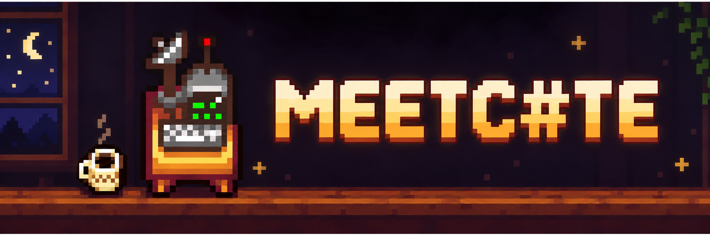

# MEETC#TE

Make a new friend for Stardew Valley. MEETC#TE is a free, fan-made character studio: give your villager a name, a voice, a daily routine, favorite gifts, heart events, portraits and a home, then put them in your game and go say hello. No coding needed.



> [!NOTE]
> MEETC#TE is an early fan project. Characters you make play through SMAPI and Content Patcher, and every character still deserves a test run in your own game before you share it.

## What you need

- **Stardew Valley 1.6** on your computer (Steam or GOG, on Windows, macOS or Linux). MEETC#TE reads your copy of the game to show real maps, portraits and menus. Nothing from the game is copied into MEETC#TE or your character projects.
- **SMAPI** and **Content Patcher** to *play* your character. You can create without them; MEETC#TE tells you when they're missing. Get them at [smapi.io](https://smapi.io/) and [Nexus Mods](https://www.nexusmods.com/stardewvalley/mods/1915).

## Start MEETC#TE

There's no installer yet, so MEETC#TE runs from this folder with [uv](https://docs.astral.sh/uv/getting-started/installation/) (version 0.12.16 or newer). Install uv once, then open a terminal in this folder and run:

```sh
uv sync --locked
uv run --locked python -m meetcute
```

uv downloads the right Python and everything else MEETC#TE needs.

## Your first visit

1. **MEETC#TE finds your game.** It checks the usual Steam and GOG places, including Steam libraries on external drives. The welcome screen says what it found, for example *Stardew Valley 1.6.15 found on Just for Fun*, and whether SMAPI and Content Patcher are installed. If it can't find the game, choose **Find Stardew Valley…** and point it at the game folder. If your game lives on a drive that's unplugged, MEETC#TE waits patiently and draws its own hearts and headings until you plug it back in.
2. **Choose New character** and type a name. That's it: MEETC#TE saves them in `Documents/MEETC#TE/<their name>/` for you, and keeps saving every change as you work.
3. **Follow the hearts.** The **Overview** page shows your character's journey as eight hearts, one per step, with a *Next up* suggestion and anything that still needs fixing.

MEETC#TE keeps to warm white and black pixel lines, so the portraits, sprites and rooms you make carry the color. The hearts and heading lettering come from your installed game. Long writing sessions are easier on the eyes with **View → Easier-to-read text**, which keeps the pixel frames but uses a plain font.

## The eight steps

| Step | What you do there |
| --- | --- |
| **About them** | Name, birthday, personality, where they live, and whether they're open to romance |
| **Conversations** | What they say day to day, how they react to your story, and married life |
| **Daily routine** | Where they go each day, and how that changes with seasons, weather and marriage |
| **Gifts** | The gifts they love, like, dislike and hate, picked from the game's items |
| **Heart events** | The scenes at 2, 4, 6, 8, 10 and 14 hearts, staged on real maps from your game |
| **Portraits & sprites** | Their portrait expressions, walking sprites, and seasonal outfits, uploaded or painted in layers |
| **Home** *(optional)* | Their home before marriage, and their spouse room and patio after |
| **Play in Stardew** | Check everything, put them in your game, and keep playtest notes |

Each finished step earns a heart in the sidebar and on the Overview.

## Write their voice

On **Conversations**, choose when a line is said in plain words: the first time you meet, on Mondays, on summer Thursdays once you're friends, on Summer 1, at the Saloon on Fridays, or when you give them a Poppy. The game's own key is shown underneath for modders. Put the cursor in a box and choose **Happy**, **Sad**, **Love** or another feeling to change their portrait; **New box** continues in the next dialogue box and **Farmer's name** greets the player by name. The preview shows each box the way the game's dialogue box does, with their portrait and name, one box at a time. Line breaks there are approximate, because the game measures its own font.

## Plan their day

On **Daily routine**, each stop has a time, a place and a spot to stand. Times read like the game's clock, from 6:00 AM to 2:00 AM. Select a stop to see its place (a map from your game, a map you supplied, or a room you designed in Home) with every stop there numbered and joined in order, drawn with your character's walking sprite. Click a tile to move the stop there or drag it, and use the arrows under the map to choose which way they face. **Conditional routines** work the same way.

## Start from a villager

Stuck on a blank page? Borrow a starting point from any villager in your game:

- **Conversations → Load dialogue template…** loads everything a villager says, like Haley's or Harvey's lines, so you can rewrite it in your character's voice.
- **Portraits & sprites → From my game…** shows a villager's portraits and walking sprites as a reference, or as starting artwork to paint over.

These read straight from your installed game. There are no console commands and no files to copy. (Want to start from a *modded* villager instead? Both windows have an **Advanced** option for Content Patcher exports.)

## Paint your own pixels

Choose **Paint…** on a portrait or sprite sheet to touch it up, recolor an outfit, or draw a new sheet from scratch. The pixel painter has layers with transparency, undo and redo, selections, mirror drawing, onion skin, a live game-size preview, and a faded reference layer you can trace. Only the finished, flattened PNG goes into the game; your layers stay in the project for next time. Your own map and Home tilesheets can be painted the same way.

MEETC#TE has no built-in AI artwork generation. If you want to use AI image tools, use them outside MEETC#TE and import the finished PNG like any other artwork. Use art you made or have permission to use.

## Design with AI (optional)

MEETC#TE can lend you an AI designer to talk through a character with: who they are, what they say, their routine and the routines that replace it on rainy days, in a season, while dating or once married, gifts, heart events, and what they say after a chapter or a wedding. It is off until you set it up under **View → Set up AI designer…**, either with an Anthropic API key or with a local model server: llama.cpp's llama-server or MLX's mlx_lm.server. While you chat, your character's text is sent to the provider you chose. Everything the designer writes is an ordinary edit you can undo, and the dialogue it writes is marked as AI-written in the project. Its words appear as it writes them: **Stop** interrupts a reply, and **New conversation** clears the chat to start again. Portraits, sprites and homes stay yours to make.

### For other AI agents

The same designer tools can serve an AI agent outside MEETC#TE, such as Claude Code or Claude Desktop, through the Model Context Protocol (MCP). Close the character in MEETC#TE first: the app saves automatically and would overwrite what the agent writes. Then give the agent this command, run from the MEETC#TE folder, with the path to the character's folder or its `character.json`:

```bash
uv run --locked python -m meetcute_designer.mcp --project "$HOME/Documents/MEETC#TE/Mira"
```

For Claude Code, the same server as an entry in `.mcp.json` (Claude Desktop's `claude_desktop_config.json` takes the same shape):

```json
{
  "mcpServers": {
    "meetcute": {
      "command": "uv",
      "args": ["run", "--locked", "--directory", "/absolute/path/to/checkout",
               "python", "-m", "meetcute_designer.mcp",
               "--project", "/Users/you/Documents/MEETC#TE/Mira"]
    }
  }
}
```

Every change the agent makes is saved to the character at once, and the dialogue it writes is marked as AI-written with the agent's name. Open the character in MEETC#TE afterwards to look it over and run **Check & export**.

## Play in Stardew

1. Open **Play in Stardew → Check & export**, fix anything it lists, and choose **Export for Stardew…**.
2. Open **Put in game & playtest** and install. MEETC#TE suggests your game's Mods folder and only ever replaces its own earlier copy of this character; your other mods are left alone.
3. Start Stardew Valley through SMAPI, meet your character, and tick off the playtest checklist.

Only heart events marked ready go into the game. Unfinished drafts stay safely in your project.

## Keeping your characters safe

- New libraries live in `Documents/MEETC#TE/`. The welcome screen also lists characters in an existing `Documents/Pixelheart/` library. If that is your only library, new characters are saved there too. Back up your library folder to keep everything, including imported artwork and homes.
- MEETC#TE saves each change a moment after you make it. The top of the window says **All changes saved**, or explains what couldn't be saved. **File → Save automatically** turns this off if you'd rather save yourself.
- **File → Save a copy…** saves a character somewhere else.
- **Edit → Undo / Redo** works across the whole character, including Home, and keeps working after MEETC#TE saves.
- Keep a character's internal name the same once you've used them in a save file.

## License

Free for personal, noncommercial modding under the [MEETC#TE Source-Available License 1.1](LICENSE). Source available, not open source. The bundled Pixelify Sans font is under the SIL Open Font License (see `meetcute/resources/fonts/OFL.txt`).

Stardew Valley is by **ConcernedApe**. MEETC#TE is an unofficial fan tool, unaffiliated with and unendorsed by ConcernedApe.
